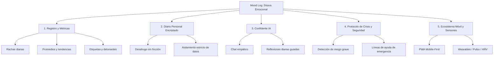

# 🧠 Documento de Visión, Arquitectura y Hoja de Ruta: Mood Log

**Versión del documento:** 2.0  
**Fecha:** Octubre 2026  
**Estado:** En transición hacia producto de consumo (B2C)  
**Rama de respaldo con módulo universitario/psicólogos:** `backup-version-universitaria`

---

## 1. Visión del Producto

### 1.1 El Concepto: "El Strava del Bienestar Emocional"
Así como **Strava** revolucionó el deporte transformando los entrenamientos en métricas visuales, rachas consistentes, mapas de esfuerzo y seguimiento pasivo mediante sensores (pulsómetros, GPS), **Mood Log** nace para hacer exactamente lo mismo con el **bienestar mental y emocional**:

1. **Fricción mínima en el registro:** Registrar cómo te sientes debe tomar 5 segundos, no 5 minutos.
2. **Cuantificación emocional visual:** Rachas de días consecutivos, promedios móviles, patrones de fluctuación semanal/mensual e impacto de hábitos.
3. **Monitoreo biométrico pasivo (Visión a futuro):** Correlacionar datos de pulso cardíaco y Variabilidad de la Frecuencia Cardíaca (VFC / HRV) provenientes de smartwatches/wearables con momentos de estrés o ansiedad.

### 1.2 El "Amigo y Confidente Personal" (IA Empática + Privacidad Total)
Además de las métricas, la aplicación ofrece un **espacio seguro, confidencial y sin juicios**:
- Un diario íntimo para desahogarse y reflexionar.
- Un compañero conversacional impulsado por IA que escucha, valida emociones y ofrece preguntas reflexivas guiadas.
- **Privacidad no negociable:** Los pensamientos íntimos del usuario deben estar estrictamente aislados y encriptados, inaccesibles para terceros.

---

## 2. Pilares Fundamentales del Sistema

### Pilar 1: Registro Rápido y Métricas (Core Strava)
- **Escala unificada:** Escala emocional clara y consistente (1 a 10) con descriptores visuales.
- **Rachas y consistencia:** Contador de días consecutivos para incentivar el hábito diario sin castigar la culpa.
- **Gráficas de progreso:** Tendencias semanales y mensuales para identificar qué días o actividades elevan o disminuyen el bienestar.

### Pilar 2: Diario Personal Confidencial
- Espacio libre de texto o notas rápidas.
- Modelo de seguridad donde **solo el UID autenticado** puede leer y escribir.

### Pilar 3: Confidente Personal (IA)
- Agente empático disponible 24/7.
- No emite diagnósticos clínicos ni prescribe tratamientos médicos; actúa como un diario interactivo y de apoyo reflexivo.

### Pilar 4: Protocolo Responsable de Contención de Crisis
- Si se detecta un patrón o lenguaje de alto riesgo (autolesión o ideación suicida), la aplicación despliega inmediatamente recursos de apoyo:
  - Botones de llamada rápida a líneas de emergencia gratuitas según el país (ej. 988 en EE.UU., 024 en España, líneas nacionales en Latinoamérica).
  - Ejercicios guiados de respiración profunda (caja / 4-7-8) para estabilización inmediata.
  - Opción de contactar a un amigo o familiar de confianza preconfigurado por el usuario.

---

## 3. Hoja de Ruta Técnica (Roadmap)

### Fase 1: Limpieza, Estabilidad y Blindaje (En curso)
- **Eliminación del módulo de psicólogos:** Retiro de rutas, páginas de citas, historias médicas y selectores de terapeutas.
- **Unificación a un solo rol:** Todos los usuarios son personas individuales gestionando su bienestar.
- **Blindaje de Firestore y Storage:** Reglas 100% cerradas a nivel de usuario (`request.auth.uid == userId`).
- **Reparación de TypeScript:** Resolución de errores de sintaxis en utilitarios y activación de `tsc --noEmit` en pipeline.

### Fase 2: Experiencia Móvil First-Class (PWA Nativa)
- **Navegación inferior tipo app nativa (Bottom Navigation Bar):**
  - Inicio / Dashboard (Rachas y métricas rápidas).
  - Registrar Ánimo (Botón central flotante).
  - Diario (Entradas y reflexiones).
  - Confidente IA (Chat de apoyo).
  - Perfil / Ajustes.
- **Gestos táctiles y transiciones móviles fluidas.**
- **Capacidad offline básica:** Posibilidad de guardar una entrada en local si no hay conexión y sincronizar al recuperar internet.

### Fase 3: Transición a Tiendas de Apps (iOS / Android)
- **Estrategia recomendada:** Integración con **Capacitor** sobre la base actual de Vite + React.
  - Permite compilar a binarios nativos para Google Play Store y Apple App Store reutilizando el 95% del código.
  - Proporciona acceso a APIs nativas de notificaciones push, almacenamiento seguro local y biometría (FaceID/huella).

### Fase 4: Integración Biométrica con Sensores (La Visión Strava)
- **Conexión con datos de salud:**
  - Integración con **Apple HealthKit** (iOS) y **Google Health Connect** (Android).
- **Métricas fisiológicas a monitorizar:**
  - **Frecuencia Cardíaca en Reposo (RHR):** Elevaciones repentinas en reposo como indicador de estrés.
  - **Variabilidad de la Frecuencia Cardíaca (HRV/VFC):** Biomarcador clínico de estrés del sistema nervioso simpático/parasimpático.
- **Disparadores inteligentes:**
  - Cuando se detecta estrés fisiológico prolongado, enviar una notificación suave invitando a una pausa de respiración o a registrar qué está ocurriendo en el momento.

---

## 4. Esquema Simplificado de Firestore

Al retirar el módulo de psicólogos, la base de datos se simplifica radicalmente:

| Colección | Propósito | Acceso / Regla de Seguridad |
|---|---|---|
| `users/{userId}` | Perfil básico del usuario (nombre, avatar, preferencias) | Solo el propio usuario (`request.auth.uid == userId`) |
| `moodLogs/{logId}` | Registros de estado de ánimo, emociones y notas | Solo el propio usuario (`resource.data.userId == request.auth.uid`) |
| `journalEntries/{entryId}` | Entradas del diario personal | Solo el propio usuario (`resource.data.userId == request.auth.uid`) |
| `chatSessions/{sessionId}` | Historial de conversaciones con el Confidente IA | Solo el propio usuario (`resource.data.userId == request.auth.uid`) |
| `userSettings/{settingsId}` | Configuraciones de tema, notificaciones y contacto de emergencia | Solo el propio usuario (`request.auth.uid == settingsId`) |

**Colecciones que se eliminan o deprecian:**
`psychologists`, `appointments`, `medicalReports`, `patientHistory`, `patients`, `psychologistRatings`.

---

## 5. Respaldo y Trazabilidad

Todo el código previo correspondiente al sistema de telepsicología, gestión de agendas y expedientes clínicos universitarios se encuentra salvaguardado en:
- **Rama Git:** `backup-version-universitaria`
- **Commit hash base:** El último commit de `main` previo a la fase de limpieza.
