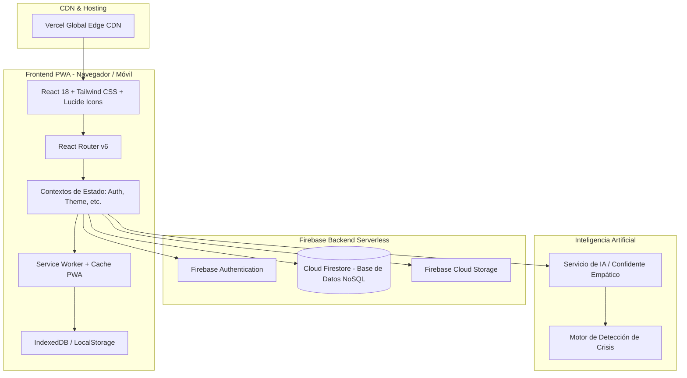

# 🏗️ Visión General de la Arquitectura

## 1. Diagrama de la Arquitectura del Sistema

**Mood Log App** está diseñada sobre una arquitectura Serverless y Jamstack moderna, maximizando la velocidad de respuesta, la disponibilidad global y el mínimo coste operativo.



---

## 2. Stack Tecnológico

| Capa | Tecnología | Propósito |
|---|---|---|
| **Lenguaje** | TypeScript 5.0+ | Tipado estático estricto en toda la aplicación |
| **Framework UI** | React 18 | Librería de interfaz reactiva y basada en componentes |
| **Empaquetador** | Vite 4.5 | Compilación ultrarrápida, HMR y optimización de chunks |
| **Estilos** | Tailwind CSS | Diseño utilitario, responsive y soporte nativo para Modo Oscuro |
| **Enrutamiento** | React Router DOM 6 | Navegación del lado del cliente (SPA) |
| **PWA** | Vite Plugin PWA (Workbox) | Manifiesto de app web, instalación en pantalla de inicio y service worker |
| **Autenticación** | Firebase Auth | Inicio de sesión con Email/Contraseña y Google OAuth |
| **Base de Datos** | Cloud Firestore | Base de datos NoSQL documental en tiempo real |
| **Almacenamiento** | Firebase Storage | Fotos de perfil y recursos multimedia de usuario |
| **Visualización** | Recharts / Chart.js / Canvas | Gráficos de tendencias emocionales y variabilidad |
| **Exportación** | jsPDF + html2canvas | Generación y descarga de resúmenes personales en PDF |

---

## 3. Organización de Directorios (`frontend/src/`)

```
frontend/src/
├── assets/             # Recursos estáticos (imágenes, logos, iconos)
├── components/         # Componentes visuales reutilizables
│   ├── ui/             # Botones, alertas, tarjetas, modales básicos
│   ├── Header.tsx      # Barra superior de navegación y perfil
│   ├── LateralSidebar.tsx # Menú lateral para escritorio
│   ├── JournalEditor.tsx  # Editor de texto para reflexiones
│   ├── MoodAnalysisDisplay.tsx # Visualizador de patrones de ánimo
│   └── ...
├── contexts/           # Proveedores de estado global
│   ├── AuthContext.tsx # Estado de usuario autenticado, roles y sesión
│   └── ThemeContext.tsx# Gestión de modo claro/oscuro
├── hooks/              # Hooks personalizados de React
│   ├── useMood.ts      # Lectura y registro de estados de ánimo
│   ├── useJournal.ts   # Carga y guardado de entradas de diario
│   ├── useChat.ts      # Manejo de mensajes del confidente IA
│   └── useUserNotifications.ts # Alertas y recordatorios
├── pages/              # Vistas principales de la aplicación
│   ├── Home.tsx        # Landing informativa de bienvenida
│   ├── DashboardSimple.tsx # Tablero principal (Strava Feed & Métricas)
│   ├── MoodFlowSimple.tsx  # Flujo de registro emocional
│   ├── Journal.tsx     # Diario personal y reflexiones
│   ├── AIChat.tsx      # Chat íntimo con el Confidente IA
│   ├── Statistics.tsx  # Métricas avanzadas, gráficas y PDF
│   ├── Profile.tsx     # Edición de perfil de usuario
│   ├── Settings.tsx    # Ajustes de privacidad, tema y seguridad
│   └── LoginSimple.tsx / RegisterSimple.tsx # Autenticación
├── services/           # Conectores con APIs externas y Firebase
│   ├── firebase.ts     # Inicialización del SDK de Firebase
│   ├── moodLogService.ts # Consultas Firestore de ánimo
│   ├── journalService.ts # Consultas Firestore de diario
│   ├── aiService.ts    # Agente de IA y análisis empático
│   ├── crisisDetection.ts # Algoritmo de detección de riesgo
│   └── pdfReportService.ts# Generador de reportes en PDF
├── types/              # Definiciones e interfaces TypeScript
│   └── index.ts        # Tipos universales (User, MoodLog, JournalEntry, etc.)
└── utils/              # Funciones auxiliares puras y formato
    ├── dateUtils.ts    # Manejo y parseo de fechas
    ├── formatters.ts   # Formato de números y porcentajes
    └── logger.ts       # Logging controlado para producción
```

---

## 4. Flujo de Datos del Usuario

1. **Autenticación:** El usuario ingresa mediante Google o email/password. `AuthContext` escucha `onAuthStateChanged` y recupera el documento `/users/{uid}`.
2. **Registro de Ánimo:**
   - La pantalla `MoodFlowSimple` captura la emoción, la escala numérica (1-10) y detonantes.
   - `moodLogService.createMoodLog()` crea el documento en Firestore asegurando que `userId == user.uid`.
3. **Reflexión en Diario:**
   - `Journal.tsx` envía la entrada a `journalService.createEntry()`.
   - Se disparan heurísticas en segundo plano para clasificar el tono emocional sin almacenar diagnósticos.
4. **Visualización de Progreso:**
   - `DashboardSimple.tsx` y `Statistics.tsx` consumen los logs con consultas indexadas (`where('userId', '==', uid)` y `orderBy('createdAt', 'desc')`), calculando medias móviles, desviaciones y rachas.
