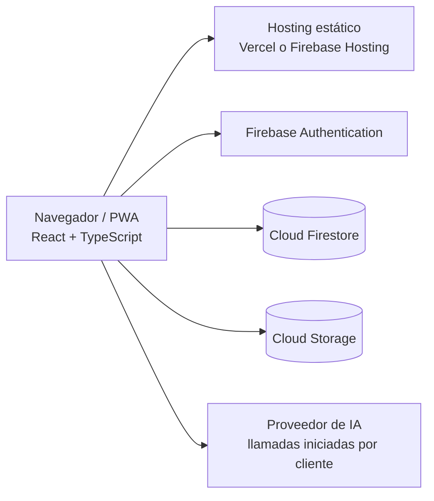

# Arquitectura de Mood Log App

## Alcance y estado

Este documento describe la implementación que se encuentra en el repositorio, no una arquitectura futura ni una garantía sobre el entorno desplegado. La aplicación está en transición hacia un producto personal B2C; todavía permanecen módulos, tipos y servicios heredados del producto anterior. Revisa [database-schema.md](./database-schema.md) y [security-and-privacy.md](./security-and-privacy.md) antes de cambiar servicios o reglas.

## Vista general

El frontend es una SPA construida con React, TypeScript y Vite. Se sirve como contenido estático y se conecta directamente desde el navegador con Firebase. En el código inspeccionado no se encontró un backend propio que medie las operaciones de Firestore ni las llamadas a proveedores de IA.



La presencia de configuración para un proveedor de hosting no confirma dónde está publicada la aplicación ni qué configuración se encuentra activa. Tampoco se verificaron los proyectos o las reglas actualmente desplegados en Firebase o Vercel.

## Componentes

| Componente | Ubicación | Responsabilidad |
|---|---|---|
| Enrutamiento y composición | `frontend/src/App.tsx` | Configura React Router, proveedores de contexto y rutas públicas/protegidas. |
| Autenticación | `frontend/src/contexts/AuthContext.tsx` | Gestiona sesión de Firebase Auth y carga/actualización de perfiles en Firestore. |
| Tema | `frontend/src/contexts/ThemeContext.tsx` | Preferencia visual y tema de la aplicación. |
| Vistas | `frontend/src/pages/` | Landing, cuenta, dashboard, registro de ánimo, diario, estadísticas, chat y ajustes. |
| Componentes | `frontend/src/components/` | Elementos visuales reutilizables, navegación, informes y mensajes. |
| Hooks | `frontend/src/hooks/` | Estado y operaciones conectadas a las vistas; algunos conservan flujos del producto anterior. |
| Servicios | `frontend/src/services/` | Firebase, acceso a datos, chat, análisis, notificaciones, crisis y exportación. |
| Tipos | `frontend/src/types/` | Modelos TypeScript; contiene todavía tipos heredados que no necesariamente representan el esquema activo. |
| Reglas e índices | `firestore.rules`, `storage.rules`, `firestore.indexes.json` | Configuración local declarativa para despliegue; no demuestra el estado remoto. |

## Flujos de datos actuales

1. **Sesión:** Firebase Auth notifica cambios a `AuthContext`; el contexto carga el documento `users/{uid}`.
2. **Registro de ánimo:** `moodLogService` escribe y consulta `moodLogs`. El objeto guardado se deriva de los datos que le pasa el llamador; los tipos y pantallas aún no comparten una escala documentada como contrato único.
3. **Diario:** `journalService` escribe en `journalEntries` y consulta plantillas/prompts. El servicio persiste contenido legible; no cifra el texto antes de enviarlo a Firestore.
4. **Chat:** el chat actual conserva sus mensajes en memoria del navegador y no usa colecciones de chat persistentes. Sus solicitudes a Groq pasan por `/api/ai`.
5. **IA:** las llamadas activas a Groq se realizan desde la función Node `/api/ai` de Vercel. Esta valida ID tokens de Firebase, limita las entradas y aplica una cuota diaria por UID; la clave se configura solo como secreto de servidor. El chat y los análisis seleccionados por el usuario transmiten su contenido a Groq.

Los detalles e incompatibilidades conocidos se registran en [database-schema.md](./database-schema.md). No tratar ninguno de estos flujos como verificado en producción sin probarlo en un entorno Firebase de desarrollo.

## PWA y ejecución sin conexión

`frontend/vite.config.ts` configura `vite-plugin-pwa` y genera recursos de service worker en el build. Esto permite instalar la web app y aplicar caché de recursos estáticos; **no implementa por sí mismo** una cola offline, sincronización de registros ni resolución de conflictos. No guardar información íntima en cachés o almacenamiento local sin una decisión de privacidad y pruebas específicas.

## Desarrollo local

Los comandos del frontend se ejecutan desde `frontend/`:

```sh
npm ci
npm run dev
npm run typecheck
npm run build
```

La guía completa está en [getting-started.md](../development/getting-started.md). El código de Firebase inicializa el cliente con configuración escrita directamente en `frontend/src/services/firebase.ts`; iniciar el frontend puede conectarlo a un proyecto compartido. Confirma el destino antes de hacer escrituras.
