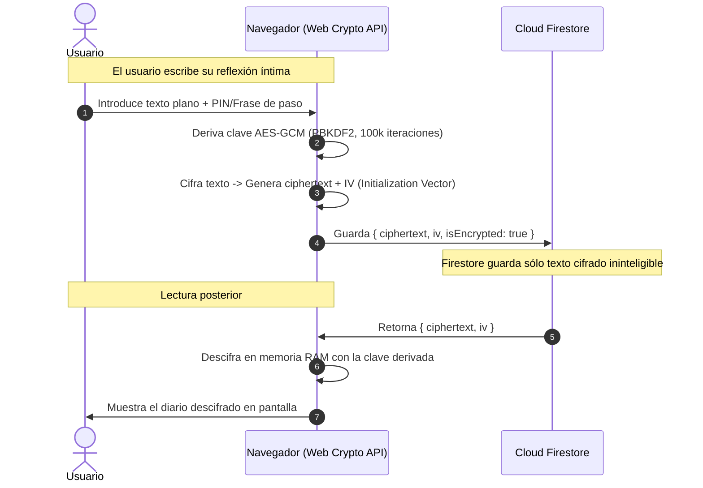

# 🔐 Seguridad, Privacidad y Modelo de Cifrado

## 1. Principio de Cero Confianza (Zero-Trust) para Datos Emocionales

Los pensamientos íntimos y registros emocionales son la categoría de datos personales más sensible de un individuo. En **Mood Log App**, la privacidad no es una opción de configuración sino un **requisito arquitectónico no negociable**.

---

## 2. Reglas de Seguridad en Cloud Firestore (`firestore.rules`)

Las reglas actuales garantizan que **ningún usuario pueda ver o modificar datos de otro usuario**, eliminando las brechas de lectura global que existían en la versión universitaria anterior:

```javascript
rules_version = '2';
service cloud.firestore {
  match /databases/{database}/documents {
    
    // Función auxiliar: verifica que el usuario esté autenticado
    function isAuthenticated() {
      return request.auth != null;
    }
    
    // Función auxiliar: verifica que el UID coincida con el dueño del recurso
    function isOwner(userId) {
      return isAuthenticated() && request.auth.uid == userId;
    }

    // Perfiles de usuario
    match /users/{userId} {
      allow read, write: if isOwner(userId);
    }

    // Registros de estado de ánimo
    match /moodLogs/{logId} {
      allow read, update, delete: if isAuthenticated() && resource.data.userId == request.auth.uid;
      allow create: if isAuthenticated() && request.resource.data.userId == request.auth.uid;
    }

    // Entradas de diario personal
    match /journalEntries/{entryId} {
      allow read, update, delete: if isAuthenticated() && resource.data.userId == request.auth.uid;
      allow create: if isAuthenticated() && request.resource.data.userId == request.auth.uid;
    }

    // Sesiones de chat con el Confidente IA
    match /chatSessions/{sessionId} {
      allow read, update, delete: if isAuthenticated() && resource.data.userId == request.auth.uid;
      allow create: if isAuthenticated() && request.resource.data.userId == request.auth.uid;
    }

    // Notificaciones individuales
    match /notifications/{notificationId} {
      allow read, update, delete: if isAuthenticated() && resource.data.userId == request.auth.uid;
      allow create: if isAuthenticated() && request.resource.data.userId == request.auth.uid;
    }
  }
}
```

---

## 3. Reglas de Seguridad en Cloud Storage (`storage.rules`)

Todo archivo multimedia (como fotos de perfil o imágenes adjuntas a un desahogo) está encapsulado en directorios prefijados por el UID:

```javascript
rules_version = '2';
service firebase.storage {
  match /b/{bucket}/o {
    
    // Solo el dueño puede leer o subir archivos dentro de su propio directorio
    match /users/{userId}/{allPaths=**} {
      allow read, write: if request.auth != null && request.auth.uid == userId;
    }
    
    // Cualquier otra ruta queda completamente denegada por defecto
    match /{allPaths=**} {
      allow read, write: if false;
    }
  }
}
```

---

## 4. Especificación del Cifrado de Extremo a Extremo (E2EE) para el Diario

Para la **Fase 3**, se implementará un esquema donde los textos del diario se cifran en el navegador antes de viajar a Firestore:



### Ventajas de esta Arquitectura:
1. **Incluso ante una brecha de base de datos**, los diarios personales son ilegibles para cualquier atacante o administrador de Firebase.
2. La clave de descifrado no se envía a ningún servidor web.
3. Se aprovecha el estándar de la industria `crypto.subtle.encrypt` nativo en navegadores modernos.
