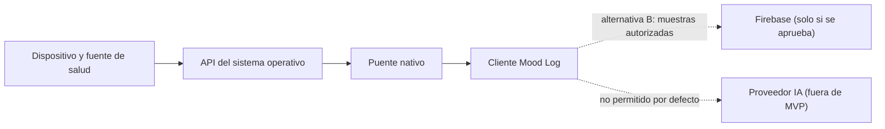

# Privacidad y seguridad: contexto biométrico

**Estado:** análisis inicial; requiere revisión del responsable de privacidad/seguridad antes de un piloto.

## 1. Principio

Los datos fisiológicos y el texto del diario pueden revelar información íntima. La configuración predeterminada debe minimizar recopilación y exposición, y cada uso debe poder explicarse a la persona. La autorización de Apple Health/Health Connect, la preferencia de Mood Log y el consentimiento para almacenamiento/uso son conceptos relacionados pero distintos.

## 2. Inventario de datos candidato

| Dato | Origen | Sensibilidad | Necesidad/uso candidato | Política pendiente |
|---|---|---|---|---|
| Frecuencia cardíaca | Plataforma de salud/dispositivo | Alta | Mostrar valor y contexto temporal. | Métrica, rango temporal, almacenamiento y retención. |
| HRV/VFC | Plataforma de salud/dispositivo | Alta | Mostrar la métrica exacta con procedencia. | SDNN/RMSSD, unidad, período y comparabilidad. |
| Registros de ánimo | Entrada de la persona | Alta | Línea de tiempo personal. | Modelo y escala canónicos pendientes en el producto actual. |
| Texto del diario | Entrada de la persona | Muy alta | Contexto de reflexión solo si se decide. | No analizar semánticamente en el MVP propuesto. |
| Consentimiento/preferencias | Persona y SO | Alta | Mantener estado de conexión y categorías autorizadas. | Dónde se guarda, versión, revocación y retención. |
| Metadatos técnicos | App | Potencialmente sensible | Depurar errores de conexión y sincronización. | Excluir muestras, texto e identificadores estables de logs. |

## 3. Flujo de datos y límites de confianza

El usuario controla permisos del sistema operativo, pero Mood Log no debe asumir que puede conocer con exactitud toda revocación en tiempo real ni borrar automáticamente registros copiados. El diseño debe detectar y comunicar cambios cuando la plataforma lo permita.

## 4. Amenazas iniciales

| Amenaza | Impacto | Controles a evaluar |
|---|---|---|
| Acceso entre cuentas | Exposición de muestras, diario o estados de ánimo. | Reglas por UID, pruebas con cuentas separadas, consultas acotadas y auditoría de servicios. |
| Clave/token de plataforma filtrado | Acceso no autorizado a datos de salud. | No persistir tokens en Firestore/logs; usar mecanismos de plataforma y almacenamiento seguro aprobado. |
| Abuso de cliente modificado | Envío de muestras inventadas o masivas. | Validación de esquema/rangos, límites; no tratar muestra cliente como certificada. |
| Compromiso de cuenta | Acceso a todo el historial personal. | Controles de Auth, reautenticación donde corresponda, sesiones seguras y proceso de recuperación. |
| Dispositivo compartido o perdido | Exposición de caché/local store. | Minimizar caché, borrado al cerrar sesión según modelo, bloqueo del dispositivo y no guardar texto adicional. |
| Logs/telemetría con contenido | Copia de datos íntimos a sistemas de observabilidad. | Logging estructurado sin valores, revisión de SDKs y pruebas de red. |
| Archivo de salud malformado o excesivo | Agotamiento de memoria/CPU o ejecución de parser insegura. | Límites de tamaño/recursos, parser endurecido, cancelación, fixtures hostiles y procesamiento local. |
| Procedencia agregada incorrectamente | Una medida manual se presenta como importada o con calidad no comprobada. | Metadatos de origen y calidad ligados a cada observación, no a un registro diario compuesto. |
| Revocación no sincronizada | Seguir importando cuando la persona cree que desconectó. | Estado visible, verificación de permisos, stop de importación y prueba de cambio desde Ajustes. |
| Eliminación incompleta | Datos quedan en Firebase, exportaciones o backups. | Inventario de copias, política de retención, proceso y evidencia de borrado. |
| Interpretación errónea | Daño por una conclusión clínica/causal falsa. | Lenguaje descriptivo, cobertura, no usar umbrales, revisión de UX y test de comprensión. |
| Fuga en IA/proveedor | Texto o biometría procesados por terceros. | Fuera del MVP; consentimiento separado, minimización y evaluación de proveedor antes de habilitar. |

Este listado inicial no sustituye modelado formal de amenazas ni una evaluación legal/regulatoria.

## 5. Controles mínimos comunes a ambas opciones

- Consentimiento propio de Mood Log antes de solicitar el permiso nativo.
- Solicitud granular de categorías necesarias y comunicación de permisos parciales.
- Recolección limitada a un propósito y ventana aprobados.
- Separación de origen: una medida importada no debe confundirse con una entrada manual.
- No usar contenido de diario ni muestras en logs, analytics, crash reports o prompts.
- No enviar datos a proveedores externos por defecto.
- Cifrado en tránsito y reposo de la plataforma, sin afirmar cifrado de extremo a extremo.
- Restricción de acceso por usuario y pruebas explícitas de denegación.
- Procedimiento para exportar, corregir y eliminar datos del lado de Mood Log.
- Retención definida antes de piloto; no conservar “por si acaso”.
- Explicación de límites y alternativa sin wearables.
- No adoptar un segundo backend ni migrar el existente sin decisión arquitectónica y plan independiente.

### Importación de archivos

- Tratar el archivo exportado como dato de salud de alta sensibilidad.
- Procesar localmente como hipótesis predeterminada del primer prototipo; no subir el archivo ni las muestras automáticamente.
- Admitir solo formatos y categorías definidos, con límite de tamaño y tiempo, cancelación y manejo explícito de errores.
- Validar entradas malformadas y limitar recursos del parser; no registrar contenido ni fragmentos del archivo.
- Descartar el archivo original y temporales al terminar, salvo que una decisión aprobada justifique conservarlos.
- Explicar antes de importar qué datos se leerán, dónde se procesarán y qué quedará almacenado.

## 6. Consideraciones específicas de persistencia

### Procesamiento local

- Documentar si los datos se mantienen en memoria, caché o almacenamiento persistente.
- Borrar datos temporales al cambiar de cuenta y definir comportamiento de cierre de sesión.
- Evaluar el riesgo de backups del dispositivo y dispositivos compartidos.
- La revocación del permiso detiene lecturas futuras; no implica que todo dato previamente almacenado en el dispositivo se haya borrado.

### Sincronización en Firebase

Antes de habilitarla:

- Aprobar un contrato de datos y una ubicación de almacenamiento.
- Definir reglas explícitas y validación de campos; la colección/subcolección no debe estar abierta a todos los usuarios autenticados.
- Decidir quién puede leer datos: solo la persona y servicios mínimos autorizados.
- Revisar copias de seguridad, exportaciones, borrado, retención y acceso administrativo.
- Evitar el uso de URLs públicas o credenciales duraderas para muestras de salud.
- Definir si la eliminación cubre réplicas, derivados, reportes y backups, con los límites temporales aplicables.

## 7. Consentimiento y ciclo de vida

Estados de producto a modelar (no esquema aprobado):

`not_connected` → `explaining` → `permission_requested` → `connected_limited` / `connected` → `revoked` / `disconnected` → `deletion_requested` → `deleted` / `deletion_failed`.

El diálogo nativo no sustituye la explicación de Mood Log. En revocación:

1. Detener nuevas importaciones tan pronto como se detecte.
2. Mantener una indicación visible de que la fuente ya no está conectada.
3. Explicar si ya existen datos copiados y cómo eliminarlos.
4. No declarar borrado hasta que se haya completado y verificado el alcance acordado.

## 8. Diario y análisis

La primera versión recomendada asocia temporalmente entradas sin leer ni clasificar el texto. Si se propone análisis semántico:

- debe ser una función separada y opcional;
- debe informar proveedor, datos enviados, finalidad y retención;
- requiere consentimiento específico y posibilidad de no participar;
- no enviar muestras biométricas y texto juntos sin necesidad demostrada;
- requiere backend protegido; no usar claves `VITE_*`;
- no presentar un resultado generativo como conclusión médica.

## 9. Revisión requerida antes del piloto

- [ ] Inventario y clasificación de datos aprobados.
- [ ] Decisión de persistencia registrada.
- [ ] Aviso/consentimiento revisado en lenguaje claro.
- [ ] Reglas y pruebas negativas por cuenta.
- [ ] Retención y eliminación documentadas, incluidos datos derivados.
- [ ] Logs, analytics y reportes revisados con datos sintéticos.
- [ ] Revisión de plataformas, jurisdicciones y políticas aplicables.
- [ ] Plan de incidentes y responsable de soporte asignados.
- [ ] Evaluación de amenazas actualizada tras seleccionar arquitectura.
- [ ] Importación de archivos revisada con límites, parser, cancelación, limpieza y pruebas de entradas malformadas.
- [ ] Backend actual confirmado; cualquier cambio/migración aprobado y planificado por separado.

## 10. Referencias para revisión de plataforma

- [Apple HealthKit documentation](https://developer.apple.com/documentation/healthkit)
- [Apple App Review Guidelines](https://developer.apple.com/app-store/review/guidelines/#health-and-health-research)
- [Android Health Connect](https://developer.android.com/health-and-fitness/health-connect)
- [Google Play User Data and sensitive permissions policy](https://support.google.com/googleplay/android-developer/answer/16558241?hl=en)

Estos enlaces son referencias iniciales, no una determinación de cumplimiento. El equipo debe revisar las versiones oficiales vigentes, los requisitos por país y la política aplicable a los datos concretos que la app proponga leer. Consultados el 14 de octubre de 2026.
