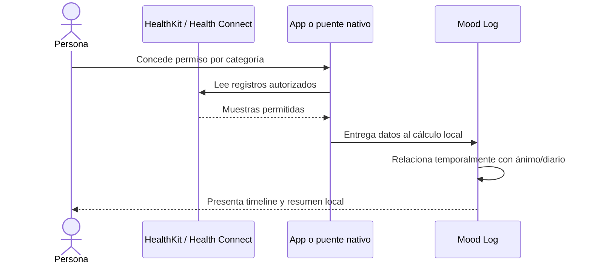
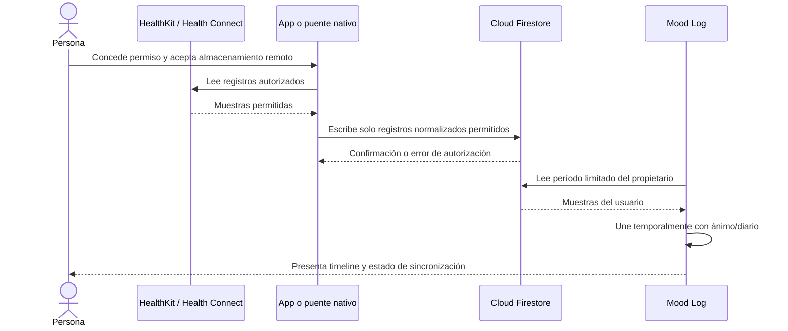

# Diseño técnico candidato: contexto biométrico

**Estado:** opciones para evaluación; no aprobado para implementación.
**Dependencias:** decisión de persistencia, alcance de plataformas y revisión de privacidad.

## 1. Contexto del sistema actual

Mood Log actualmente es una SPA React/Vite que accede directamente a Firebase desde el navegador. El repositorio no contiene Capacitor ni una integración nativa identificada con HealthKit o Health Connect. Las reglas y esquemas de Firestore necesitan consolidación antes de añadir una colección sensible. La implementación de esta feature sería un cambio arquitectónico, no solo una nueva pantalla.

La propuesta de producto recibida presupone Enter Cloud y otro esquema, mientras que este repositorio documenta Firebase. No se debe crear una segunda capa de backend ni ejecutar una migración como parte tácita de la feature. La decisión sobre proveedor, migración y estrategia de datos requiere evaluación independiente, plan de reversión y aprobación explícita.

## 2. Restricción de plataforma

Apple Health/HealthKit y Android Health Connect son capacidades de plataforma. No asumir que la PWA web actual puede consultar sus datos históricos. El acceso requiere evaluar una app nativa o un puente/plugin con permisos del sistema operativo y validar las APIs, políticas y dispositivos objetivo vigentes.

Capacitor es una alternativa por investigar, no una decisión tomada. Debe construirse una prueba de concepto que confirme lectura de las métricas requeridas, permisos parciales, revocación, sincronización y comportamiento en dispositivos reales.

## 3. Alternativas de persistencia

### Opción A — Procesamiento local, sin persistir muestras biométricas en Firebase



**Ventajas:** menor persistencia centralizada; evita sincronizar muestras sensibles; reduce exposición en reglas, copias de seguridad y administración.

**Costos/riesgos:** análisis disponible solo en el dispositivo que tiene acceso; posible relectura de rangos; diferencias de plataforma; mayor complejidad al limpiar cachés y cambiar de cuenta; no facilita una vista consistente entre dispositivos.

### Opción B — Importar y sincronizar en Firebase



**Ventajas:** análisis entre dispositivos; potencial de consulta histórica y experiencia más consistente.

**Costos/riesgos:** aumenta superficie de acceso, impacto de una filtración, carga de reglas, retención, borrado, backups y obligaciones de proveedor; puede almacenar más datos de los estrictamente necesarios. La confiabilidad de una medición no queda verificada por guardarla en Firestore.

### Opción C — Piloto comparativo

Probar ambas alternativas con datos sintéticos y, solo tras revisión y consentimiento específicos, un grupo limitado de prueba. Comparar utilidad, comprensión, sincronización, impacto en batería, control del usuario y carga de borrado antes de elegir. No enviar muestras reales al entorno de prueba sin autorización y controles aprobados.

## 4. Recomendación provisional

Para el primer prototipo, usar datos sintéticos; para un piloto real, evaluar primero Opción A y almacenar solo los registros de ánimo/diario ya existentes según sus controles actuales. No persistir muestras biométricas en la nube hasta justificar claramente la sincronización entre dispositivos.

Esta es una recomendación, no una decisión aprobada. La elección debe cerrarse mediante ADR-BIO-001 después de la evaluación de privacidad, producto y tecnología.

## 5. Componentes lógicos propuestos

| Componente | Responsabilidad | Límite |
|---|---|---|
| Adaptador de plataforma | Solicitar/consultar datos permitidos en APIs nativas. | No ejecutar diagnósticos ni decidir estados de riesgo. |
| Normalizador | Convertir datos a un formato común manteniendo valor, unidad, métrica, origen y timestamp original. | No mezclar métricas o unidades incompatibles. |
| Gestor de consentimiento | Registrar la preferencia de Mood Log y reflejar permisos del SO. | No guardar tokens de plataforma ni suplantar permisos del sistema. |
| Repositorio de importación | Implementar la política elegida: memoria/local o persistencia autorizada. | No usar cloud sin decisión y reglas probadas. |
| Correlador temporal | Consultar datos dentro de una ventana explícita y presentar coexistencia temporal. | No inferir causalidad, emoción, condición o crisis. |
| Presentación | Línea de tiempo, filtros, cobertura, origen y mensajes de error. | No ocultar datos ausentes o permiso revocado. |

## 6. Modelo canónico de muestra (borrador)

Este es un contrato conceptual; no crear la colección hasta cerrar la política de persistencia.

```ts
interface ImportedHealthSample {
  metric: 'heart_rate' | 'hrv_sdnn' | 'hrv_rmssd';
  value: number;
  unit: 'bpm' | 'ms';
  recordingMode: 'instant' | 'interval' | 'aggregate';
  periodStart: string;
  periodEnd?: string;
  source: 'apple_health' | 'health_connect';
  sourceDevice?: string;
  importedAt: string;
  sourceRecordRef?: string;
}
```

Notas:

- Las marcas temporales deben conservar la semántica original de zona horaria/timestamp; un dato puntual puede representarse con `periodStart` igual a su instante de captura y `periodEnd` ausente. El tipo anterior es ilustrativo y requiere refinamiento.
- Métricas HRV deben discriminar algoritmo, origen, unidad y, si la API lo ofrece, ventana/contexto. SDNN y RMSSD no son intercambiables.
- Debe definirse validación de valores y versiones del esquema; no asumir que todo dato fuente es válido.
- `sourceRecordRef` solo se conservará si es necesario para deduplicar o gestionar cambios y tras revisar si es identificador persistente. Preferir identificadores locales no reversibles cuando sea posible; no incluir identificadores de salud en logs.
- No guardar permisos/tokens nativos dentro de un documento Firestore.
- La relación con diario debe ser un cálculo/vista derivada, no duplicar el texto de la entrada en la muestra.
- La fuente y la calidad pertenecen a cada observación. No añadir campos globales como `metrics_source` o `metrics_quality` a un registro diario si ese registro puede combinar entradas manuales e importadas; decidir un contrato de medición independiente antes de persistir.

## 6.1 Importación de archivos

Una importación de archivo es una alternativa candidata para evaluar especialmente en iOS, no una integración ya disponible ni una garantía de acceso a Apple Health. Antes de procesar archivos reales, definir:

- formatos/exportaciones admitidos y versiones del formato;
- límites de tamaño, tiempo y memoria, así como cancelación y manejo de errores;
- procesamiento local por defecto para el primer prototipo y ausencia de subida automática;
- extracción mínima de categorías aprobadas, evitando conservar el archivo completo si no es necesario;
- limpieza de temporales, cachés y datos al cambiar de cuenta o cerrar sesión;
- validación de XML y protección frente a entradas malformadas o expansivas;
- lenguaje de interfaz que explique claramente qué se conserva y qué no.

La prueba inicial debe utilizar fixtures sintéticos. No enviar exportaciones reales a servicios externos, logs, analítica ni herramientas de depuración.

## 7. Modelo de persistencia en Firebase, solo si se aprueba Opción B

Si se decide almacenamiento remoto, evaluar una subcolección por usuario, por ejemplo:

```text
users/{uid}/healthSamples/{sampleId}
```

La estructura es candidata, no esquema aprobado. Las reglas deberían validar:

- `request.auth.uid == uid`;
- campos exactos permitidos y tipos/rangos;
- inmutabilidad de propietario, fuente y marca temporal cuando corresponda;
- límite de volumen/payload y límites contra abuso;
- operaciones específicas para crear, leer, actualizar y borrar.

La estructura anidada no hereda automáticamente reglas de `/users/{uid}`. Debe existir un `match` explícito y pruebas negativas para otro UID. No confiar en reglas cliente para demostrar que una muestra proviene realmente del dispositivo; la app debe describirla como importada, no certificada.

## 8. Sincronización e integridad

Si hay sincronización:

- Definir paginación/rangos y cursor por fuente sin asumir que ambas plataformas ofrecen el mismo mecanismo.
- Diseñar idempotencia para lecturas repetidas y edición/eliminación en la fuente cuando estas se puedan detectar.
- Tratar la sincronización como potencialmente parcial, reintentable e interrumpible.
- No sobrescribir datos fuente por un error temporal ni borrar datos ya sincronizados sin confirmación del alcance.
- Exponer estado por fuente: conectado, permiso parcial, última sincronización, error, revocado.
- Definir reglas para registros atrasados, cambio de zona horaria y muestras duplicadas.
- Establecer límites de consulta y agregación antes de añadir índices.

## 9. Unión temporal con ánimo y diario

La relación debe ser explícita y reproducible:

1. La persona selecciona un período.
2. Se recuperan registros de ánimo, entradas y mediciones permitidas para ese rango.
3. Se normalizan los timestamps para presentar una zona horaria seleccionada.
4. Se asocian elementos dentro de una ventana temporal definida por producto.
5. Se muestran conteos/cobertura y valores faltantes.

La ventana y zona horaria por defecto quedan pendientes. El sistema no debe usar “antes/después” como argumento causal. La primera versión no debería analizar semánticamente el contenido del diario.

## 10. Errores y estados

Diseñar y probar por separado:

- plataforma o dispositivo no compatible;
- app sin permiso o con permiso parcial;
- permiso revocado en Ajustes del sistema;
- sensor/fuente sin registros;
- fallo temporal del puente o Firebase;
- sesión cerrada o cambio de cuenta;
- duplicados o datos tardíos;
- carga/caché local agotada;
- borrado parcial o fallo en remoto;
- actualización de versión con esquema anterior.

Cada error debe distinguir “no hay datos” de “no se pudieron leer datos”. No convertir errores en gráficos vacíos sin informar causa.

## 11. Decisiones técnicas pendientes

- ¿Persistencia local únicamente, Firebase o piloto comparativo?
- ¿La integración nativa se hará con Capacitor u otra opción?
- ¿Qué métricas y endpoints exactos se soportan en la primera plataforma?
- ¿Se retienen muestras completas, agregados o solo se consultan bajo demanda?
- ¿Cómo se gestionan consistencia, revocación y borrado de backups?
- ¿Cómo se comporta la app al cambiar de dispositivo/cuenta?
- ¿Se requiere backend de confianza para sincronización o procesamiento?

## 12. Referencias técnicas primarias

Las fuentes siguientes son puntos de partida para la investigación. No sustituyen la revisión de versiones vigentes de APIs, requisitos de plataforma o políticas de publicación antes de implementar:

- [HealthKit — Apple Developer Documentation](https://developer.apple.com/documentation/healthkit)
- [Health Connect — Android Developers](https://developer.android.com/health-and-fitness/health-connect)
- [Apple App Review Guidelines](https://developer.apple.com/app-store/review/guidelines/#health-and-health-research)
- [Google Play — User Data and sensitive permissions](https://support.google.com/googleplay/android-developer/answer/16558241?hl=en)

**Consulta documental:** 14 de octubre de 2026. Las plataformas actualizan APIs y políticas; registrar la fecha y verificar de nuevo antes de cada release.

Para las reglas de presentación y asociación de datos, consultar también la [metodología de análisis](analysis-methodology.md).
