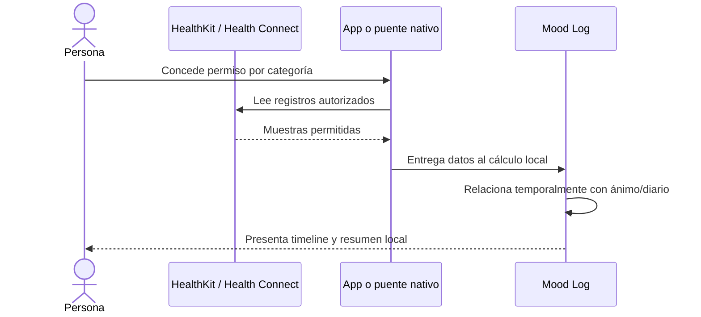
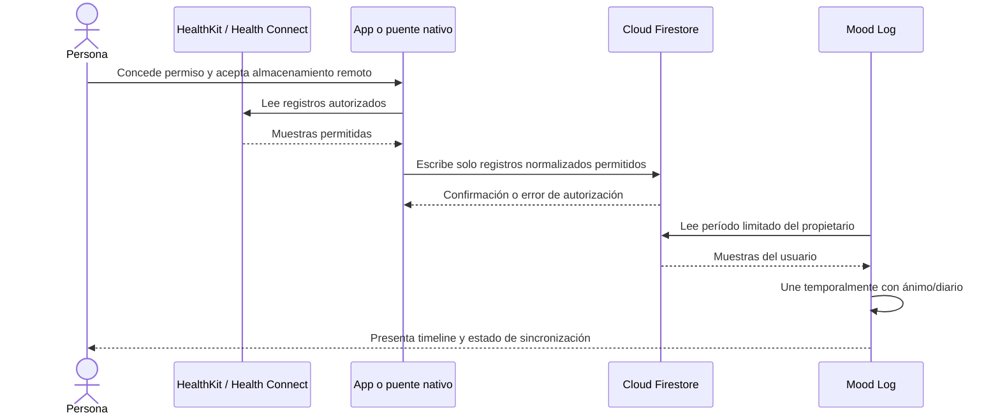

# Diseño técnico candidato: contexto biométrico

**Estado:** almacenamiento local solo en el reloj elegido para la siguiente etapa longitudinal; implementación pendiente hasta definir retención, cifrado, borrado, exportación y controles de privacidad.
**Dependencias:** contrato local de datos y controles pendientes, alcance de plataformas y revisión de privacidad.

## 1. Contexto del sistema actual

Mood Log actualmente es una SPA React/Vite que accede directamente a Firebase desde el navegador. El repositorio no contiene Capacitor ni una integración nativa identificada con HealthKit o Health Connect. Las reglas y esquemas de Firestore necesitan consolidación antes de añadir una colección sensible. La implementación de esta feature sería un cambio arquitectónico, no solo una nueva pantalla.

La propuesta de producto recibida presupone Enter Cloud y otro esquema, mientras que este repositorio documenta Firebase. No se debe crear una segunda capa de backend ni ejecutar una migración como parte tácita de la feature. La decisión sobre proveedor, migración y estrategia de datos requiere evaluación independiente, plan de reversión y aprobación explícita.

El módulo fuente Wear OS vive en `wearos/` y consulta Health Services mediante `MeasureClient`; el contenedor móvil Capacitor vive aparte en `frontend/android/`. El prototipo del reloj compiló e instaló en el AVD `MoodLogWearOS36` el 20-11-2026, pero todavía no persiste observaciones ni se ha validado con un sensor físico. Antes de añadir persistencia longitudinal, separar pantalla/estado de interacción, lectura de sensor, consentimiento y repositorio. El repositorio debe ser el único punto de entrada a las muestras y aplicar retención, cifrado, borrado y exclusión de backups. Mantener el almacenamiento local del reloj independiente de Firebase y del frontend web.

## 2. Restricción de plataforma

Apple Health/HealthKit y Android Health Connect son capacidades de plataforma. No asumir que la PWA web actual puede consultar sus datos históricos. El acceso requiere evaluar una app nativa o un puente/plugin con permisos del sistema operativo y validar las APIs, políticas y dispositivos objetivo vigentes.

Capacitor es una alternativa por investigar, no una decisión tomada. Debe construirse una prueba de concepto que confirme lectura de las métricas requeridas, permisos parciales, revocación, sincronización y comportamiento en dispositivos reales.

### 2.1 Compatibilidad observada en documentación oficial

La primera prueba Android solicitada es una app directa para Wear OS con una medición puntual de pulso durante un check-in manual. Una app móvil que lea Health Connect es una vía adicional para datos que otras apps ya hayan escrito; no sustituye la experiencia en el reloj. No asumir que una PWA puede acceder a sensores nativos ni que todo reloj compatible con Health Connect ejecute Wear OS.

| Plataforma | Ruta práctica candidata | Datos relevantes | Restricción que afecta el diseño |
|---|---|---|---|
| Wear OS (prototipo Android directo) | App nativa de reloj consulta Health Services mediante `MeasureClient` durante una lectura activa iniciada por usuario. | `HEART_RATE_BPM`; `MeasureClient` devuelve lecturas y disponibilidad mientras la experiencia está activa. | El permiso depende de la versión: el prototipo declara `BODY_SENSORS` con límite de SDK 35 y `android.permission.health.READ_HEART_RATE` para SDK 36+. El código selecciona el permiso según `Build.VERSION.SDK_INT`. Lecturas puntuales no equivalen a historia continua; no se debe asumir monitoreo pasivo ni compatibilidad de todos los relojes. |
| Android móvil / Health Connect (complemento) | App Android consulta datos que una app de reloj o salud ya escribió en Health Connect. La PWA no basta. | `HeartRateRecord` es serie temporal; `HeartRateVariabilityRmssdRecord` usa RMSSD. | Requiere Android 9+ con Google Play Services; Android 14+ integra Health Connect y versiones anteriores requieren su app. El acceso por defecto a datos de otras fuentes cubre 30 días previos al permiso; historial más antiguo requiere permiso adicional. La disponibilidad depende del reloj/app origen. |
| iOS / Apple Watch (etapa posterior) | App iOS con HealthKit consulta muestras que el sistema sincroniza en Health. | HealthKit expone `heartRate`, `restingHeartRate` y HRV SDNN. | Requiere capability/entitlement de HealthKit y textos de permiso en la app. Apple deliberadamente no permite saber si la persona negó lectura de un tipo; “sin resultados” no puede presentarse como prueba de que no existen datos. El acceso a historia puede ser limitado a una ventana reciente y hay que respetar la fecha autorizada. |

No mezclar HRV SDNN de HealthKit con RMSSD de Health Connect bajo una sola métrica “HRV”; conservar definición, origen, unidad y método por observación. Para una primera comparación entre ecosistemas, priorizar pulso con procedencia y contexto y dejar HRV como métrica distinta y opcional. Una opción sin sensores y un registro manual de ánimo deben seguir disponibles.

**Restricción de desarrollo del equipo:** el checkout se trabaja actualmente en Windows. Android puede prototiparse en este entorno, pero el trabajo de HealthKit exige Xcode y validación en el entorno Apple; antes de comprometer un MVP iOS hay que disponer de Mac/Xcode y dispositivos de prueba. No usar un plugin como prueba de compatibilidad sin verificar permiso, lectura, revocación y publicación en cada sistema.

**Fuentes oficiales revisadas el 20 de noviembre de 2026:** [Health Services en Wear OS](https://developer.android.com/health-and-fitness/health-services), [lectura puntual con MeasureClient](https://developer.android.com/health-and-fitness/health-services/active-data/measure-client), [permisos de Health Services por versión](https://developer.android.com/health-and-fitness/health-services/permissions), [compatibilidad y datos por dispositivo](https://developer.android.com/health-and-fitness/health-services/compatibility), [integrar una app Wear OS](https://developer.android.com/health-and-fitness/fitness/basic-app/integrate-wear-os), [HealthKit, autorización de lectura](https://developer.apple.com/documentation/healthkit/authorizing-access-to-health-data), [tipos HealthKit](https://developer.apple.com/documentation/healthkit/hkquantitytypeidentifier), [Health Connect, tipos de datos](https://developer.android.com/health-and-fitness/health-connect/data-types), [disponibilidad de Health Connect](https://developer.android.com/health-and-fitness/health-connect/availability), [Health Connect, lectura y límites históricos](https://developer.android.com/health-and-fitness/health-connect/read-data).

La guía oficial de permisos indica que para Wear OS 6/API 36 o posterior las APIs que antes requerían `BODY_SENSORS` deben usar permisos de salud como `android.permission.health.READ_HEART_RATE`; por eso el manifiesto limita el permiso anterior a API 35 y el código selecciona el nuevo desde API 36. Que el tipo `HEART_RATE_BPM` esté soportado no garantiza que cada fabricante produzca una lectura en cada intento. Hay que validar solicitud, denegación, revocación, disponibilidad y medición en emuladores y modelos físicos antes de afirmar compatibilidad. Esta revisión documental no sustituye esa prueba. [Permisos oficiales de Health Services](https://developer.android.com/health-and-fitness/health-services/permissions), [matriz oficial de compatibilidad](https://developer.android.com/health-and-fitness/health-services/compatibility).

El callback del prototipo convierte la duración desde el arranque de `SampleDataPoint` a `Instant` usando el tiempo de arranque calculado con reloj de pared menos `SystemClock.elapsedRealtime()`, según la [referencia oficial de `SampleDataPoint.getTimeInstant`](https://developer.android.com/reference/androidx/health/services/client/data/SampleDataPoint#getTimeInstant(java.time.Instant)). Si Health Services entrega más de una muestra por callback, el prototipo selecciona la muestra válida con el instante más reciente, no depende del orden de la lista.

## 3. Alternativas de persistencia

### Opción A — Procesamiento local, sin persistir muestras biométricas en Firebase



**Ventajas:** menor persistencia centralizada; evita sincronizar muestras sensibles; reduce exposición en reglas, copias de seguridad y administración.

**Costos/riesgos:** análisis disponible solo en el dispositivo que tiene acceso; posible relectura de rangos; diferencias de plataforma; mayor complejidad al limpiar cachés y cambiar de cuenta; no facilita una vista consistente entre dispositivos.

### Opción B — Importar y sincronizar en Firebase



**Ventajas:** análisis entre dispositivos; potencial de consulta histórica y experiencia más consistente.

**Costos/riesgos:** aumenta superficie de acceso, impacto de una filtración, carga de reglas, retención, borrado, backups y obligaciones de proveedor; puede almacenar más datos de los estrictamente necesarios. La confiabilidad de una medición no queda verificada por guardarla en Firestore.

### Opción C — Persistencia privada local solo en el reloj (elegida)

Guardar observaciones longitudinales en almacenamiento privado de la app Wear OS. No crear copia en teléfono, Data Layer, Firebase ni proveedor externo. Esta opción reduce transferencias y evita una base central de muestras, pero requiere decidir ubicación y cifrado de archivos/base local, claves, acceso en reloj desbloqueado, copias/respaldo del sistema, retención, exportación, eliminación y tratamiento ante pérdida o cambio de dispositivo. No asumir que “privado de la app” equivale a cifrado o ausencia de respaldo. La decisión está elegida para la siguiente etapa, pero no se debe implementar hasta cerrar los controles y autorización.

### Opción D — Piloto comparativo (alternativa no elegida)

Esta alternativa compararía estrategias de almacenamiento; no es el siguiente paso aprobado. Una comparación posterior solo tendría sentido con pregunta de investigación, protocolo, revisión ética/legal y consentimiento específicos; no enviar muestras reales hasta cerrar esas condiciones.

## 4. Decisión para la siguiente iteración

Para el siguiente prototipo longitudinal, implementar la opción C y usar fixtures sintéticos durante la construcción. La app actual continúa sin persistir muestras. La decisión excluye copia al teléfono y sincronización con Firebase, Wear OS Data Layer, otros servicios de Google o proveedores externos para esta etapa. Reabrirla requiere otro ADR y evaluación de privacidad.

La dirección de persistencia está registrada en ADR-BIO-001. La recomendación concreta de controles para la siguiente iteración está en ADR-BIO-014: archivo cifrado local, datos mínimos, retención propuesta de 90 días, borrado desde el reloj y fallo cerrado. No está implementada ni aprobada jurídicamente; no habilita datos reales ni un piloto.

## 5. Componentes lógicos propuestos

| Componente | Responsabilidad | Límite |
|---|---|---|
| Adaptador de plataforma | Solicitar/consultar datos permitidos en APIs nativas. | No ejecutar diagnósticos ni decidir estados de riesgo. |
| Normalizador | Convertir datos a un formato común manteniendo valor, unidad, métrica, origen y timestamp original. | No mezclar métricas o unidades incompatibles. |
| Gestor de consentimiento | Registrar la preferencia de Mood Log y reflejar permisos del SO. | No guardar tokens de plataforma ni suplantar permisos del sistema. |
| Repositorio de importación | Implementar la política elegida: memoria/local o persistencia autorizada. | No usar cloud sin decisión y reglas probadas. |
| Correlador temporal | Consultar datos dentro de una ventana explícita y presentar coexistencia temporal. | No inferir causalidad, emoción, condición o crisis. |
| Presentación | Línea de tiempo, filtros, cobertura, origen y mensajes de error. | No ocultar datos ausentes o permiso revocado. |

## 6. Modelo canónico de muestra (borrador)

Este es un contrato conceptual; no crear la colección hasta cerrar la política de persistencia.

```ts
interface ImportedHealthSample {
  metric: 'heart_rate' | 'hrv_sdnn' | 'hrv_rmssd';
  value: number;
  unit: 'bpm' | 'ms';
  recordingMode: 'instant' | 'interval' | 'aggregate';
  periodStart: string;
  periodEnd?: string;
  source: 'apple_health' | 'health_connect';
  sourceDevice?: string;
  importedAt: string;
  sourceRecordRef?: string;
}
```

Notas:

- Las marcas temporales deben conservar la semántica original de zona horaria/timestamp; un dato puntual puede representarse con `periodStart` igual a su instante de captura y `periodEnd` ausente. El tipo anterior es ilustrativo y requiere refinamiento.
- Métricas HRV deben discriminar algoritmo, origen, unidad y, si la API lo ofrece, ventana/contexto. SDNN y RMSSD no son intercambiables.
- Debe definirse validación de valores y versiones del esquema; no asumir que todo dato fuente es válido.
- `sourceRecordRef` solo se conservará si es necesario para deduplicar o gestionar cambios y tras revisar si es identificador persistente. Preferir identificadores locales no reversibles cuando sea posible; no incluir identificadores de salud en logs.
- No guardar permisos/tokens nativos dentro de un documento Firestore.
- La relación con diario debe ser un cálculo/vista derivada, no duplicar el texto de la entrada en la muestra.
- La fuente y la calidad pertenecen a cada observación. No añadir campos globales como `metrics_source` o `metrics_quality` a un registro diario si ese registro puede combinar entradas manuales e importadas; decidir un contrato de medición independiente antes de persistir.

## 6.1 Importación de archivos

Una importación de archivo es una alternativa candidata para evaluar especialmente en iOS, no una integración ya disponible ni una garantía de acceso a Apple Health. Antes de procesar archivos reales, definir:

- formatos/exportaciones admitidos y versiones del formato;
- límites de tamaño, tiempo y memoria, así como cancelación y manejo de errores;
- procesamiento local por defecto para el primer prototipo y ausencia de subida automática;
- extracción mínima de categorías aprobadas, evitando conservar el archivo completo si no es necesario;
- limpieza de temporales, cachés y datos al cambiar de cuenta o cerrar sesión;
- validación de XML y protección frente a entradas malformadas o expansivas;
- lenguaje de interfaz que explique claramente qué se conserva y qué no.

La prueba inicial debe utilizar fixtures sintéticos. No enviar exportaciones reales a servicios externos, logs, analítica ni herramientas de depuración.

## 7. Modelo de persistencia en Firebase, solo si se aprueba Opción B

Si se decide almacenamiento remoto, evaluar una subcolección por usuario, por ejemplo:

```text
users/{uid}/healthSamples/{sampleId}
```

La estructura es candidata, no esquema aprobado. Las reglas deberían validar:

- `request.auth.uid == uid`;
- campos exactos permitidos y tipos/rangos;
- inmutabilidad de propietario, fuente y marca temporal cuando corresponda;
- límite de volumen/payload y límites contra abuso;
- operaciones específicas para crear, leer, actualizar y borrar.

La estructura anidada no hereda automáticamente reglas de `/users/{uid}`. Debe existir un `match` explícito y pruebas negativas para otro UID. No confiar en reglas cliente para demostrar que una muestra proviene realmente del dispositivo; la app debe describirla como importada, no certificada.

## 8. Sincronización e integridad

Si hay sincronización:

- Definir paginación/rangos y cursor por fuente sin asumir que ambas plataformas ofrecen el mismo mecanismo.
- Diseñar idempotencia para lecturas repetidas y edición/eliminación en la fuente cuando estas se puedan detectar.
- Tratar la sincronización como potencialmente parcial, reintentable e interrumpible.
- No sobrescribir datos fuente por un error temporal ni borrar datos ya sincronizados sin confirmación del alcance.
- Exponer estado por fuente: conectado, permiso parcial, última sincronización, error, revocado.
- Definir reglas para registros atrasados, cambio de zona horaria y muestras duplicadas.
- Establecer límites de consulta y agregación antes de añadir índices.

## 9. Unión temporal con ánimo y diario

La relación debe ser explícita y reproducible:

1. La persona selecciona un período.
2. Se recuperan registros de ánimo, entradas y mediciones permitidas para ese rango.
3. Se normalizan los timestamps para presentar una zona horaria seleccionada.
4. Se asocian elementos dentro de una ventana temporal definida por producto.
5. Se muestran conteos/cobertura y valores faltantes.

La ventana y zona horaria por defecto quedan pendientes. El sistema no debe usar “antes/después” como argumento causal. La primera versión no debería analizar semánticamente el contenido del diario.

## 10. Errores y estados

Diseñar y probar por separado:

- plataforma o dispositivo no compatible;
- app sin permiso o con permiso parcial;
- permiso revocado en Ajustes del sistema;
- sensor/fuente sin registros;
- fallo temporal del puente o Firebase;
- sesión cerrada o cambio de cuenta;
- duplicados o datos tardíos;
- carga/caché local agotada;
- borrado parcial o fallo en remoto;
- actualización de versión con esquema anterior.

Cada error debe distinguir “no hay datos” de “no se pudieron leer datos”. No convertir errores en gráficos vacíos sin informar causa.

## 11. Decisiones técnicas pendientes

- La persistencia local únicamente en el reloj ya fue elegida en ADR-BIO-001; implementar solo después de cerrar las puertas del ADR-BIO-014.
- ¿La integración nativa se hará con Capacitor u otra opción?
- ¿Qué métricas y endpoints exactos se soportan en la primera plataforma?
- ¿Se conserva el dato de pulso puntual junto al check-in o se derivan agregados locales; cuál método descriptivo y ventana temporal se validan?
- ¿Cómo se gestionan consistencia, revocación y borrado de backups?
- ¿Cómo se comporta la app al cambiar de dispositivo/cuenta?
- ¿Se requiere backend de confianza para sincronización o procesamiento?

## 12. Referencias técnicas primarias

Las fuentes siguientes son puntos de partida para la investigación. No sustituyen la revisión de versiones vigentes de APIs, requisitos de plataforma o políticas de publicación antes de implementar:

- [HealthKit — Apple Developer Documentation](https://developer.apple.com/documentation/healthkit)
- [Health Connect — Android Developers](https://developer.android.com/health-and-fitness/health-connect)
- [Apple App Review Guidelines](https://developer.apple.com/app-store/review/guidelines/#health-and-health-research)
- [Google Play — User Data and sensitive permissions](https://support.google.com/googleplay/android-developer/answer/16558241?hl=en)

**Consulta documental:** 14 de octubre de 2026. Las plataformas actualizan APIs y políticas; registrar la fecha y verificar de nuevo antes de cada release.

Para las reglas de presentación y asociación de datos, consultar también la [metodología de análisis](analysis-methodology.md).
