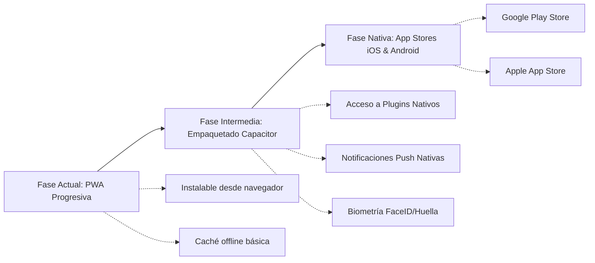

# 📱 Estrategia Móvil (Mobile-First)

## 1. La Experiencia Móvil de "El Strava del Bienestar"

El 90% de las interacciones con una aplicación de registro de ánimo ocurren en momentos de pausa rápida: al despertar, en el transporte público, antes de entrar a una reunión o al acostarse.

Para que el usuario forme un hábito duradero, la aplicación debe sentirse como una app móvil nativa, ultrarrápida y libre de menús engorrosos de escritorio.

---

## 2. Barra de Navegación Inferior (Bottom Navigation Bar)

La navegación táctil se rediseña alrededor de 5 puntos accesibles con el pulgar:

```
┌────────────────────────────────────────────────────────┐
│                                                        │
│                    Área de Contenido                   │
│                                                        │
├─────────┬─────────┬──────────────┬──────────┬──────────┤
│    🏠   │    📖   │      ➕      │    📊    │    ⚙️    │
│  Inicio │  Diario │  Registrar   │ Métricas │  Ajustes │
└─────────┴─────────┴──────────────┴──────────┴──────────┘
```

| Elemento | Destino | Propósito |
|---|---|---|
| **🏠 Inicio** | `/dashboard` | Resumen del día, racha activa en llamas, promedios y últimas entradas |
| **📖 Diario** | `/journal` | Espacio de escritura reflexiva y acceso al Confidente IA |
| **➕ Registrar (Central)** | `/mood-flow` | **Acción primaria:** Botón flotante destacado para calificar el ánimo en 5 segundos |
| **📊 Métricas** | `/statistics` | Gráficos de evolución semanal, mapa de calor y detonantes |
| **⚙️ Ajustes** | `/settings` | Perfil, modo oscuro, seguridad y preferencias |

---

## 3. Hoja de Ruta Móvil: De PWA a Tiendas Nativas (Capacitor)



### ¿Por qué Capacitor sobre React Native o Flutter?
1. **Reutilización del 100% del código:** Toda la base actual de React 18, Vite y Tailwind CSS funciona directamente dentro de un contenedor WebView nativo de ultra-alto rendimiento.
2. **Despliegues unificados:** Una sola base de código para Web, iOS y Android.
3. **Acceso a hardware nativo:** Sensores de pulso, almacenamiento cifrado seguro en Keychain/Keystore y notificaciones push sin reescribir la UI.

---

## 4. Diseño Táctil y Ergonomía

1. **Áreas de toque mínimas de 44x44px:** Para botones e iconos, garantizando accesibilidad según las guías de Apple (Human Interface Guidelines) y Google (Material Design).
2. **Safe Area Insets:** Compatibilidad con la barra de inicio y el "notch" de iPhone usando `padding-bottom: env(safe-area-inset-bottom)`.
3. **Vibración háptica (Haptic Feedback):** Respuesta física sutil al deslizar el selector de ánimo de 1 a 10.
