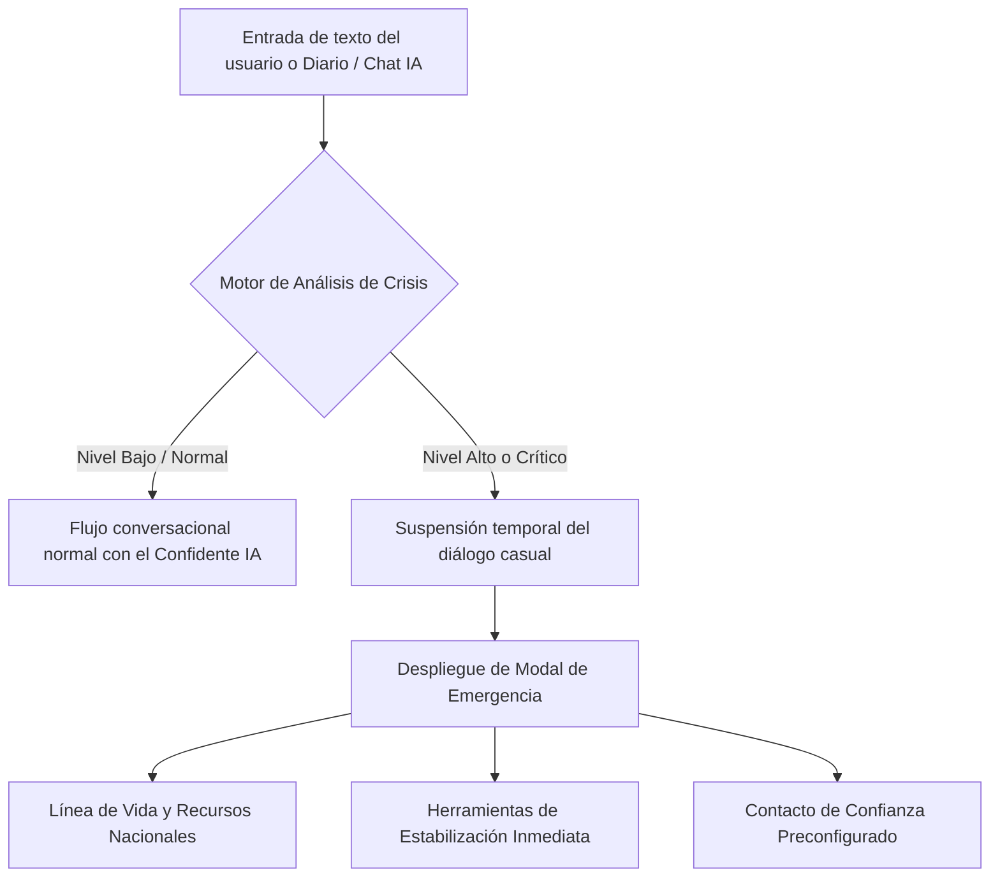

# 🚨 Protocolo de Contención de Crisis y Asistencia de Emergencia

## 1. Declaración Ética y Límites de la Aplicación

> [!CAUTION]
> **Mood Log App NO es un servicio de urgencias médicas ni un psicólogo clínico colegiado.**  
> La aplicación no emite diagnósticos psiquiátricos, no prescribe medicación ni sustituye la atención profesional presencial. Su función es la auto-observación, la gestión del hábito de bienestar y el desahogo personal asistido por IA empática.

Ante situaciones donde un usuario exprese ideación suicida, autolesiones inminentes o episodios psicóticos agudos, la plataforma activa de inmediato el **Protocolo de Contención de Crisis**.

---

## 2. Flujo de Detección y Respuesta

---

## 3. Criterios de Detección

El servicio `src/services/crisisDetection.ts` evalúa patrones semánticos y lingüísticos:
1. **Intención autolítica explícita:** Frases relacionadas con terminar la vida, suicidio, despedidas terminales o métodos de daño físico.
2. **Puntuación de ánimo extrema sostenida:** Reportes consecutivos de ánimo 1/10 acompañados de términos de desesperanza total o falta de salida.
3. **Pérdida de contacto con la realidad:** Expresiones de angustia delirante o terror extremo.

---

## 4. Recursos de Apoyo y Líneas de Emergencia por País

Cuando se detecta una crisis, la aplicación presenta una tarjeta destacada con botones de marcación telefónica directa:

| Región / País | Servicio / Entidad | Teléfono / Marcación | Modalidad |
|---|---|---|---|
| **Internacional / EE. UU.** | Suicide & Crisis Lifeline | **988** | Llamada o SMS gratuita 24/7 |
| **España** | Línea de Atención a la Conducta Suicida | **024** | Gratuita, confidencial 24/7 |
| **México** | Línea de la Vida | **800 911 2000** | Gratuita 24/7 |
| **Colombia** | Línea 106 / Línea Calma (Bogotá) | **106** / **01 8000 423 614** | Gratuita |
| **Argentina** | Centro de Asistencia al Suicida | **135** (CABA) o **(011) 5275-1135** | Gratuita |
| **Chile** | Fono Salud Responde | ***4141** | Gratuito desde celular |

---

## 5. Herramientas de Estabilización en App

En paralelo al número de emergencia, la aplicación ofrece micro-intervenciones para desacelerar el pánico fisiológico:
1. **Respiración Guiada Cuadrada (Box Breathing / 4-7-8):** Animación visual para sincronizar la respiración pulmonar y activar el nervio vago.
2. **Técnica de Aterrizaje 5-4-3-2-1:** Ejercicio guiado para reenfocar la mente en estímulos sensoriales del entorno inmediato.
3. **Botón de Contacto Seguro:** Botón para enviar un mensaje rápido a un amigo, pareja o familiar previamente registrado en la configuración del usuario.
