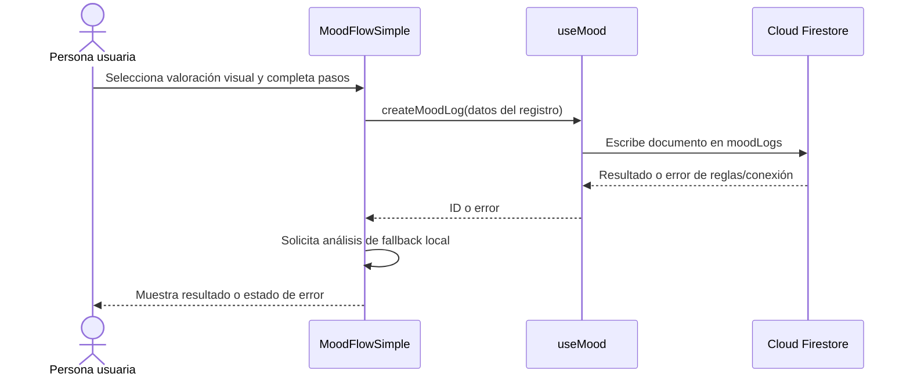
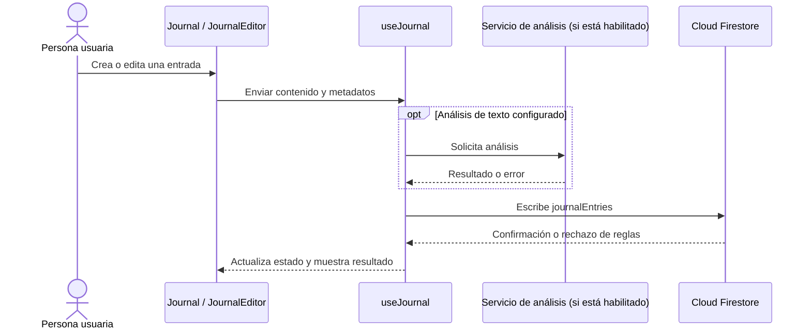
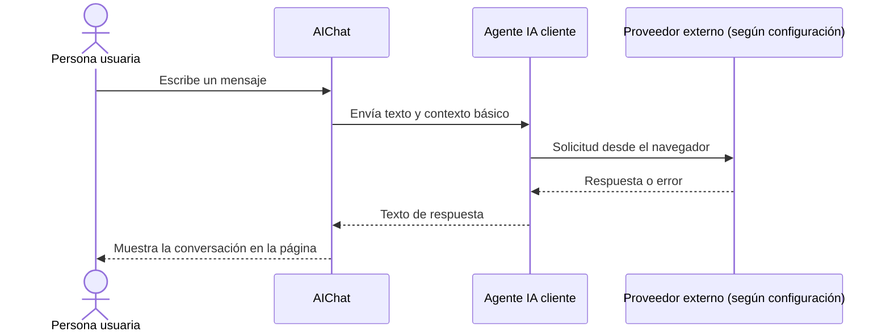
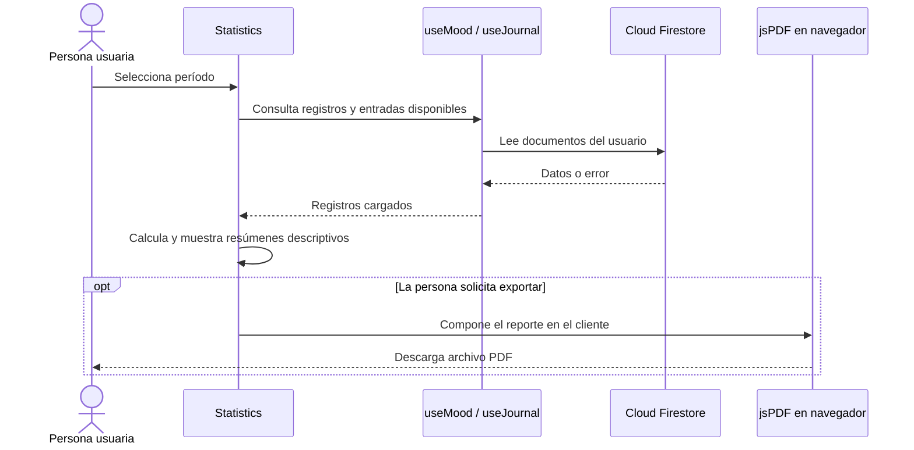
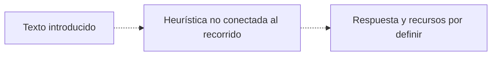

# Flujos principales de usuario

## Propósito y límites

Los diagramas representan recorridos objetivo y puntos de integración del código revisado. No son pruebas de que la configuración de Firebase, IA o producción esté disponible. Las brechas actuales están señaladas para evitar confundir diseño con comportamiento probado.

## 1. Registro de ánimo

**Estado observado:** el formulario y servicio existen. `useMood` agrega el UID actual al registro. La escala del tipo compartido y algunos documentos no coincide con el selector visual; las reglas y el modelo deben probarse en desarrollo.

**No asumir:** actualización de una racha persistida, una puntuación clínica, guardado del resultado de IA mostrado o funcionamiento sin conexión.

## 2. Diario

**Estado observado:** el hook/servicio permite operaciones de diario y suscripción a entradas. El contenido se guarda legible. La configuración actual de reglas y los accesos de IA requieren revisión; no describir el diario como cifrado.

## 3. Chat de apoyo

**Estado observado:** los mensajes se mantienen en estado de la página; no se encontró persistencia en este componente. El servicio se ejecuta desde el cliente y puede requerir una clave `VITE_*`. El historial se pierde al desmontar/recargar la vista. El motor heurístico de crisis del repositorio no aparece conectado a este flujo.

**Bloqueantes antes de habilitar con datos reales:** backend seguro, consentimiento y minimización, revisión de nombres/textos que sugieren atención profesional, política de retención y plan de errores/abuso.

## 4. Estadísticas y exportación

La exportación se genera en el dispositivo según la implementación revisada. Antes de compartir un PDF, la persona debe poder revisar su contenido; los datos resumidos no prueban causalidad ni son una evaluación clínica.

## 5. Crisis y ayuda inmediata: no es un flujo operativo

El repositorio contiene lógica heurística de detección y menciona colecciones para evaluaciones, pero no se encontró una llamada a `detectCrisisSignals` desde las páginas de registro, diario o chat, ni un flujo integrado que garantice respuesta inmediata. Las reglas locales tampoco autorizan las colecciones de crisis mencionadas por ese servicio.

Por lo tanto, no presentar actualmente esta secuencia como función disponible:

El [protocolo de crisis](./crisis-protocol.md) describe los requisitos que deben cumplirse antes de diseñar o anunciar una capacidad de apoyo de emergencia.
