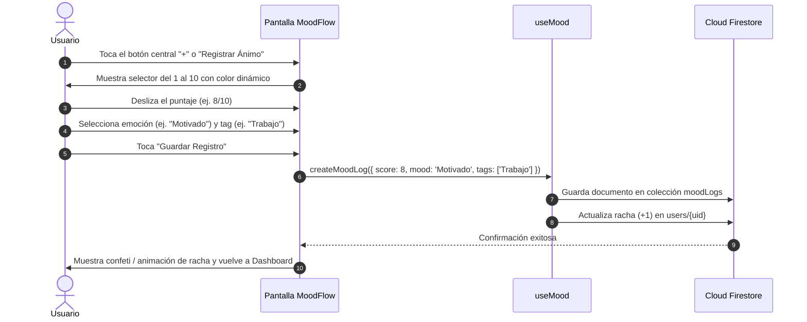
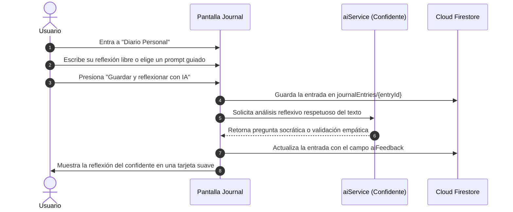
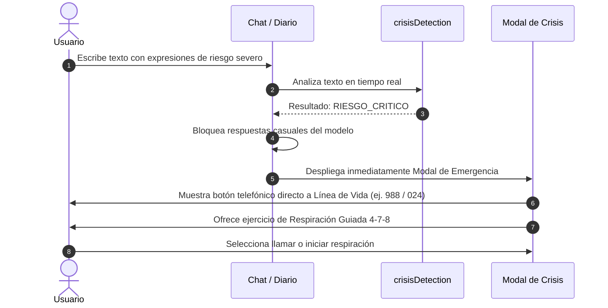
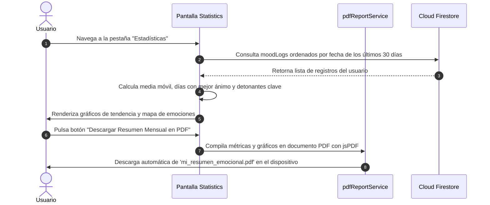

# 🔄 Flujos de Usuario Principales (User Journeys)

Este documento detalla los 4 flujos principales de experiencia del usuario en **Mood Log App**, ilustrando el paso a paso tanto a nivel de interfaz como a nivel de datos.

---

## Flujo 1: Registro Rápido Diario (Check-in Emocional)

Este es el flujo nuclear de la aplicación (objetivo: completarse en menos de 5 segundos).

---

## Flujo 2: Desahogo en el Diario con Respuesta Empática

El usuario utiliza el diario para exteriorizar pensamientos profundos y recibir retroalimentación reflexiva.

---

## Flujo 3: Activación del Protocolo de Contención de Crisis

Si en cualquier momento la persona escribe palabras de autolesión o ideación autolítica, se activa la respuesta de protección inmediata.

---

## Flujo 4: Consulta de Progreso y Descarga de PDF

El usuario revisa su consistencia a lo largo del mes y genera un informe personal.

