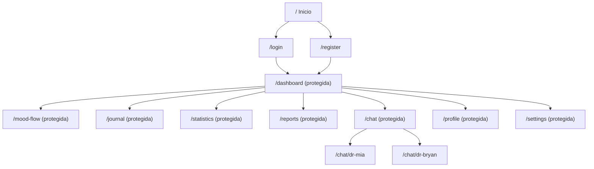

# Guía de pantallas y estado funcional

## A quién va dirigida

Esta guía explica las rutas visibles en el frontend actual. Es una referencia del código, no una garantía de que cada acción funcione con la configuración remota disponible. Las rutas y protecciones se definen en `frontend/src/App.tsx`; las operaciones sensibles dependen de Firebase y sus reglas.

> **Nota de seguridad:** la aplicación está en transición y contiene funciones experimentales. No uses información personal real en pruebas. El chat puede enviar contenido a un proveedor externo; el diario se almacena en texto legible y la detección de crisis no está conectada al flujo de usuario revisado.

## Mapa de navegación

La app también define `/complete-profile`, `/forgot-password`, `/privacy` y `/terms`. Las rutas con protección requieren sesión según `ProtectedRoute`, con comportamiento de redirección a completar perfil cuando faltan ciertos campos.

## Pantallas

### Inicio (`/`)

Landing pública que presenta la propuesta y ofrece accesos a cuenta. La visibilidad de esta página no convierte el sitio completo en privado.

### Registro e inicio de sesión (`/register`, `/login`)

Formularios de cuenta conectados con Firebase Authentication. El código contempla correo/contraseña y Google. El comportamiento real depende de Authentication, los dominios autorizados y la configuración de Firebase.

### Completar perfil (`/complete-profile`)

Formulario de perfil accesible mediante ruta propia. No trates los campos de perfil o el rol recibido desde el cliente como mecanismo de autorización. La persistencia y reglas deben probarse.

### Dashboard (`/dashboard`)

Vista protegida que muestra saludo, acceso al diario, registros recientes y métricas derivadas de los datos cargados. Los cálculos de promedio/racha se realizan en el frontend con los registros disponibles; no son indicadores clínicos. Comprueba errores y sincronización con Firestore.

### Registro de ánimo (`/mood-flow`)

Recorrido por pasos que pide una valoración visual de 1 a 10, una descripción de cómo se siente la persona y detalles opcionales de energía, estrés, sueño, actividades y emociones. Al guardar, intenta crear un documento en `moodLogs` y muestra una pantalla de análisis.

El tipo compartido de Firestore aún describe otra escala en sus comentarios; unifica el contrato antes de interpretar tendencias antiguas o comparar puntuaciones. El análisis disponible en `aiService` usa un fallback local; no debe presentarse como evaluación profesional o diagnóstico.

### Diario (`/journal`)

Permite consultar entradas y ofrece acciones para crear, editar, buscar o eliminar; también presenta plantillas/prompts. El contenido se guarda como texto legible en Firestore. El sistema puede intentar analizar el texto con IA según la configuración y el contenido; consulta [Seguridad y privacidad](../architecture/security-and-privacy.md) antes de usarlo con información íntima.

### Estadísticas (`/statistics`)

Presenta resúmenes y gráficos generados a partir de los registros disponibles, con selección de período y acción para exportar un PDF local. Los resultados son descriptivos del autorreporte; no identifican causas ni predicen condiciones clínicas. Verifica los límites temporales y valores exportados antes de depender del reporte.

### Informes (`/reports`)

Ruta protegida a informes avanzados. La persistencia y disponibilidad de esta funcionalidad deben confirmarse con las reglas y el servicio; su presencia en la ruta no garantiza que los informes se guarden en Firestore.

### Selección y chat (`/chat`, `/chat/dr-mia`, `/chat/dr-bryan`, `/chat/ai/:doctorType`)

La interfaz actual ofrece perfiles llamados Mia y Bryan con descripciones de apoyo. El componente puede enviar mensajes a agentes inicializados desde el navegador. El historial se mantiene en estado de la página y no se observó persistencia de la conversación en ese componente.

Los nombres/textos visibles incluyen lenguaje médico/profesional que debe revisarse: el producto no debe representar a un agente como médico o psicólogo real. El detector de crisis del repositorio no está conectado a este chat. No introduzcas datos sensibles hasta que estén implementados controles, consentimiento y backend seguro.

### Perfil y ajustes (`/profile`, `/settings`)

Rutas protegidas para información personal y preferencias. Confirma en el código cada operación de cuenta, cambio de contraseña, borrado o contacto de emergencia antes de presentarla como disponible; la interfaz por sí sola no prueba que se complete correctamente.

### Privacidad y términos (`/privacy`, `/terms`)

Páginas públicas de información legal. Su redacción debe revisarse contra el comportamiento real, proveedores y jurisdicciones antes de usar la aplicación con público.

## Capacidades futuras que no deben darse por disponibles

- Cifrado de extremo a extremo del diario.
- Sincronización completa sin conexión.
- Respuesta humana o atención de emergencia desde la app.
- Detección fiable de crisis.
- Conexión a wearables o sensores.
- Aplicación nativa distribuida en tiendas.

Consulta el [roadmap](./vision-and-roadmap.md) para el estado y criterios de avance.
