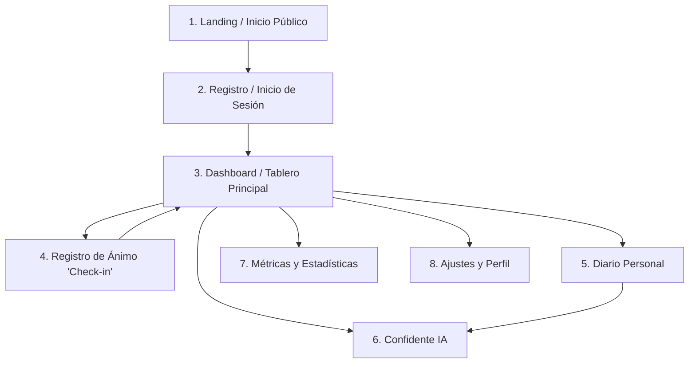

# 📱 Guía Funcional y Manual de Usuario (Pantalla a Pantalla)

Esta guía explica en detalle cada pantalla y funcionalidad de **Mood Log App** para que cualquier usuario, diseñador, evaluador o nuevo desarrollador comprenda exactamente la experiencia de uso de la plataforma.

---

## 🗺️ Mapa de Pantallas de la Aplicación

---

## 1. Landing de Bienvenida (`/`)
- **Propósito:** Presentar la propuesta de valor a usuarios nuevos y permitir el acceso a usuarios recurrentes.
- **Elementos clave:**
  - Resumen visual de la plataforma (cuantificación emocional, privacidad total, confidente IA).
  - Botón principal de llamada a la acción (*Comenzar ahora / Registrarse*).
  - Acceso directo a inicio de sesión (*¿Ya tienes cuenta? Iniciar Sesión*).
  - Enlaces al pie de página a las Políticas de Privacidad y Términos de Servicio.

---

## 2. Registro e Inicio de Sesión (`/login`, `/register`)
- **Propósito:** Autenticar al usuario de forma rápida y segura.
- **Métodos disponibles:**
  - **Google OAuth (Un clic):** Inicio instantáneo vinculando la cuenta de Google con un solo toque (recomendado en móvil).
  - **Correo electrónico y contraseña:** Formulario tradicional con validación de contraseña segura.
- **Seguridad:** Encriptación en tránsito con TLS/SSL y gestión de tokens a través de Firebase Authentication. Al iniciar sesión por primera vez, se genera automáticamente el perfil del usuario con rol `'user'` y racha inicial de 0 días.

---

## 3. Tablero Principal / Dashboard (`/dashboard`)
- **Propósito:** El "Feed de Actividad" (núcleo del concepto Strava Emocional).
- **Lo que ve el usuario:**
  - **Tarjeta de Bienvenida:** Saludo personalizado según la hora del día y recordatorio de registrar el ánimo si aún no lo ha hecho hoy.
  - **Medidor de Racha (🔥 Streak):** Contador visible de días consecutivos registrando emociones. Si el usuario registra hoy, el fuego se enciende.
  - **Estado Actual:** Indicador del último ánimo registrado con su color e icono representativo.
  - **Acceso Rápido Central (+):** Botón prominente para registrar cómo te sientes en este instante.
  - **Historial Reciente:** Lista de los últimos registros con fecha, nivel del 1 al 10 y emociones asociadas.

---

## 4. Flujo de Registro de Ánimo (`/mood-flow`)
- **Propósito:** Capturar la emoción en menos de 5 segundos con mínima fricción cognitiva.
- **Paso a Paso:**
  1. **Nivel de Bienestar (Slider 1 al 10):**
     - 1-3: Rojo / Naranja (Muy mal, decaído, abrumado).
     - 4-6: Amarillo / Neutro (Regular, cansado, normal).
     - 7-8: Verde claro (Bien, tranquilo, motivado).
     - 9-10: Verde esmeralda (Excelente, pleno, eufórico).
  2. **Selección de Emociones:** Tarjetas seleccionables con emojis descriptivos (*Agradecido, Ansioso, Cansado, Enojado, Feliz, Inspirado, Solitario*).
  3. **Detonantes o Contexto:** Etiquetas de un toque para identificar qué originó la emoción (*Trabajo, Familia, Pareja, Clima, Sueño, Ejercicio, Salud, Dinero*).
  4. **Nota Opcional:** Campo de texto breve para añadir detalles antes de guardar.
- **Resultado:** El registro se guarda en Firestore, actualiza la racha del usuario y redirige al dashboard.

---

## 5. Diario Personal (`/journal`)
- **Propósito:** Espacio íntimo de desahogo y reflexión escrita.
- **Funcionalidades:**
  - **Editor libre:** Área para escribir reflexiones largas o notas breves.
  - **Prompts Guiados:** Sugerencias reflexivas para desbloquear la escritura (*"¿Qué es algo que hoy te quitó energía y cómo puedes soltarlo?", "¿Por qué cosas te sientes agradecido hoy?"*).
  - **Historial cronológico:** Consulta de entradas anteriores organizadas por fecha.
  - **Respuesta empática opcional:** Posibilidad de solicitar una devolución reflexiva generada por el Confidente IA sobre la entrada escrita.

---

## 6. Confidente Personal con IA (`/ai-chat`)
- **Propósito:** Un compañero conversacional disponible 24/7 para escuchar y reflexionar sin juicios.
- **Dinámica:**
  - El usuario escribe lo que tiene en mente y el asistente responde con empatía, validación y preguntas orientadas al autodescubrimiento.
  - **No es terapia clínica:** Si el usuario expresa angustia extrema o ideación autolesiva, el chat detiene la conversación casual y despliega inmediatamente el **Protocolo de Contención de Crisis** con botones de llamada a líneas de vida de emergencia gratuitas.

---

## 7. Estadísticas y Métricas (`/statistics`)
- **Propósito:** Mostrar tendencias, patrones y evolución temporal del bienestar.
- **Componentes:**
  - **Gráfico de Evolución Temporal:** Curva de altibajos a lo largo de los últimos 7, 30 o 90 días.
  - **Distribución de Emociones:** Gráfico circular mostrando qué porcentaje del tiempo la persona experimenta cada emoción.
  - **Detonantes Más Frecuentes:** Identificación de qué factores se correlacionan con los días de menor y mayor puntuación.
  - **Descarga de Reporte PDF:** Botón para generar un documento PDF descargable con el resumen del mes.

---

## 8. Perfil y Ajustes (`/profile`, `/settings`)
- **Propósito:** Configuración de la cuenta y preferencias personales.
- **Opciones disponibles:**
  - Actualización de nombre visible y fotografía de avatar.
  - Alternador de **Modo Claro / Modo Oscuro**.
  - Cambio seguro de contraseña o reautenticación con Google.
  - Configuración de contactos de emergencia.
  - Enlaces directos a las políticas de privacidad y términos de servicio.
  - Botón de cierre de sesión seguro.
