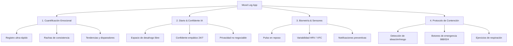

# 🎯 Visión de Producto y Hoja de Ruta

## 1. El Concepto: "El Strava del Bienestar Emocional"

**Strava** transformó el atletismo y el ciclismo no porque obligara a la gente a correr, sino porque:
1. Permitió registrar una sesión en 3 segundos o de forma pasiva con sensores.
2. Hizo visibles las métricas: ritmos, mapas de esfuerzo, consistencia y rachas.
3. Creó una cultura de progreso personal sin juzgar el nivel del atleta.

**Mood Log App** aplica exactamente esta misma filosofía a la salud mental y emocional:
- **Cero fricción:** Registrar el estado anímico actual toma entre 3 y 5 segundos (emoción base + intensidad 1-10 + etiquetas opcionales).
- **Consistencia visible (Rachas):** Celebrar los días consecutivos de auto-observación para formar un hábito de introspección saludable.
- **Mapas de fluctuación emocional:** Gráficas intuitivas de promedios móviles, patrones según el día de la semana y correlación con actividades cotidianas (sueño, trabajo, ejercicio, relaciones).
- **Cuantificación biométrica (Fase Strava IoT):** Medir variaciones fisiológicas involuntarias (frecuencia cardíaca en reposo y variabilidad del pulso) para alertar antes de que la persona experimente un colapso de estrés o ansiedad.

---

## 2. El Confidente y Diario Íntimo con IA

Además de la capa cuantitativa de métricas, la aplicación provee un espacio íntimo y seguro:
- **Diario personal:** Un rincón para descargar pensamientos sin filtros.
- **Confidente IA empático:** Un agente conversacional que actúa como un diario interactivo:
  - Escucha activa y validación emocional.
  - Preguntas reflexivas (estilo socrático / estoico / mindfulness).
  - No juzga, no etiqueta clínicamente, no da órdenes.
- **Aislamiento absoluto:** Los datos del diario están protegidos con reglas estrictas y diseñados para futura encriptación en el dispositivo del usuario.

---

## 3. Pilares del Producto

---

## 4. Fases de Ejecución (Roadmap)

### Fase 1: Limpieza, Robustez y Rol Único (Completada ✅)
- Eliminación total del módulo universitario de psicólogos, agendas de citas y expedientes médicos.
- Unificación a rol único de consumidor (`user`).
- Blindaje de reglas de Firestore y Storage por ID de usuario.
- Reparación completa de TypeScript (cero errores en `npm run typecheck`) y generación limpia de build.

### Fase 2: Experiencia Móvil First-Class & Navegación Strava (En curso ⏳)
- Incorporación de barra de navegación inferior fija (`Bottom Navigation Bar`):
  - 🏠 **Inicio / Feed:** Resumen del día, estado actual, racha activa y gráfico rápido.
  - ➕ **Registro Rápido:** Botón flotante central de acción inmediata (slider 1-10 + emoción).
  - 📖 **Diario & Confidente:** Entrada guiada y chat empático.
  - 📊 **Estadísticas:** Análisis de tendencias, disparadores y patrones semanales.
  - 👤 **Perfil & Ajustes:** Preferencias, seguridad y tema.
- Interfaz táctil optimizada para pantallas móviles y PWA instalable en iOS y Android.

### Fase 3: Encriptación del Diario & Almacenamiento Seguro
- Cifrado local de entradas de diario mediante `Web Crypto API` (AES-GCM de 256 bits).
- La clave nunca abandona el dispositivo del usuario; en Firestore se almacenan únicamente bloques cifrados (`ciphertext`).

### Fase 4: Envoltorio Nativo (Capacitor) para App Stores
- Empaquetado del frontend existente con **Capacitor**.
- Publicación directa en **Google Play Store** y **Apple App Store**.
- Notificaciones push nativas para recordatorios de check-in emocional.
- Bloqueo biométrico de la aplicación (Face ID / Huella digital).

### Fase 5: Integración Biométrica y Wearables (Visión IoT)
- Conexión con **Apple HealthKit** (iOS) y **Google Health Connect** (Android).
- Detección de picos de estrés mediante frecuencia cardíaca en reposo y HRV.
- Disparadores inteligentes: sugerencia automática de un ejercicio de respiración o check-in al detectar estrés fisiológico prolongado.
