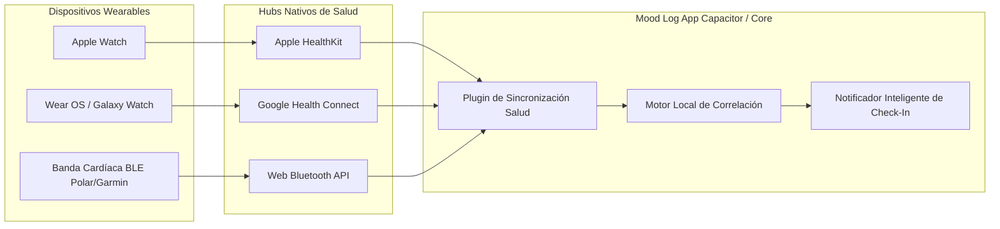

# 💓 Integración Biométrica y Wearables (La Visión Strava)

## 1. Justificación y Fundamento Científico

El registro consciente del estado de ánimo (auto-reporte) tiene una limitación conocida: **el sesgo cognitivo retrospectivo** (a menudo nos damos cuenta de que estuvimos ansiosos o enojados horas después del suceso).

Para lograr una verdadera plataforma predictiva y preventiva, **Mood Log** complementará el registro consciente con biomarcadores fisiológicos en tiempo real provenientes de smartwatches y bandas cardíacas:

| Biomarcador | Definición | Relevancia en Salud Emocional |
|---|---|---|
| **Frecuencia Cardíaca en Reposo (RHR)** | Latidos por minuto en ausencia de actividad física | Picos de RHR sostenidos sin movimiento físico correlacionan fuertemente con estrés agudo o fatiga mental. |
| **Variabilidad del Ritmo Cardíaco (HRV / VFC)** | Variación de tiempo en milisegundos entre latidos sucesivos (SDNN / RMSSD) | **El biomarcador por excelencia del sistema nervioso autónomo:** Alta HRV = sistema parasimpático activo (calma, recuperación). Baja HRV = sistema simpático activo (alerta, estrés, pánico). |
| **Temperatura cutánea y respuesta galvánica** | Micro-cambios de conductancia en la piel | Respuestas simpáticas inmediatas ante estímulos de sobresalto o angustia. |

---

## 2. Arquitectura de Conexión con Dispositivos



---

## 3. Estrategia de Implementación por Entorno

### 3.1 Entorno Web / PWA: `Web Bluetooth API`
Para usuarios que usan la versión web en navegadores compatibles (Chrome, Edge, Opera):
- Conexión directa vía Bluetooth Low Energy (BLE) utilizando el servicio estándar `0x180D` (Heart Rate Service).
- Lectura en tiempo real del pulso instantáneo y los intervalos RR (`Heart Rate Measurement: 0x2A37`).
- Ideal para sesiones guiadas de meditación y respiración dentro del navegador.

```typescript
// Ejemplo de conexión BLE estándar en el navegador
async function connectHeartRateMonitor(): Promise<BluetoothRemoteGATTCharacteristic> {
  const device = await navigator.bluetooth.requestDevice({
    filters: [{ services: ['heart_rate'] }]
  });
  const server = await device.gatt?.connect();
  const service = await server?.getPrimaryService('heart_rate');
  const characteristic = await service?.getCharacteristic('heart_rate_measurement');
  return characteristic!;
}
```

### 3.2 Entorno Móvil Nativo (Capacitor): HealthKit & Health Connect
Al empacar la aplicación en iOS y Android:
- **iOS:** Integración con `@capacitor-community/health` hacia Apple HealthKit (permiso de lectura para `HKQuantityTypeIdentifierHeartRate` y `HKQuantityTypeIdentifierHeartRateVariabilitySDNN`).
- **Android:** Integración con Google Health Connect (lectura de registros `HeartRateRecord` y `HeartRateVariabilityRmssdRecord`).

---

## 4. Algoritmo de Detección de Estrés y Disparadores

1. **Línea base individual (Baseline):**
   - La aplicación aprende la frecuencia cardíaca promedio en reposo del usuario y su rango normal de HRV durante 7 días.
2. **Detección de anomalía:**
   - Si se detecta un incremento sostenido de FC (> 25% sobre la línea base) por más de 10 minutos **sin detección de pasos o aceleración física**:
   - Y la HRV cae por debajo del percentil 15 habitual.
3. **Acción de apoyo suave (Micro-intervención):**
   - Notificación no invasiva: *"Tu cuerpo parece estar acelerado. ¿Quieres tomarte 60 segundos para respirar o anotar qué está pasando?"*.
   - Si el usuario pulsa la notificación, se abre directamente la pantalla de **Respiración 4-7-8** o el **Registro Rápido de Ánimo**.

---

## 5. Privacidad y Ética de Datos de Salud

- **Procesamiento en el dispositivo:** La correlación inicial de biometría se calcula localmente en el teléfono.
- **Consentimiento explícito:** Los permisos de salud son estrictamente opcionales y pueden revocarse en cualquier momento.
- **No comercialización:** Los datos biométricos jamás serán compartidos ni vendidos a brokers de datos, redes publicitarias ni aseguradoras.
